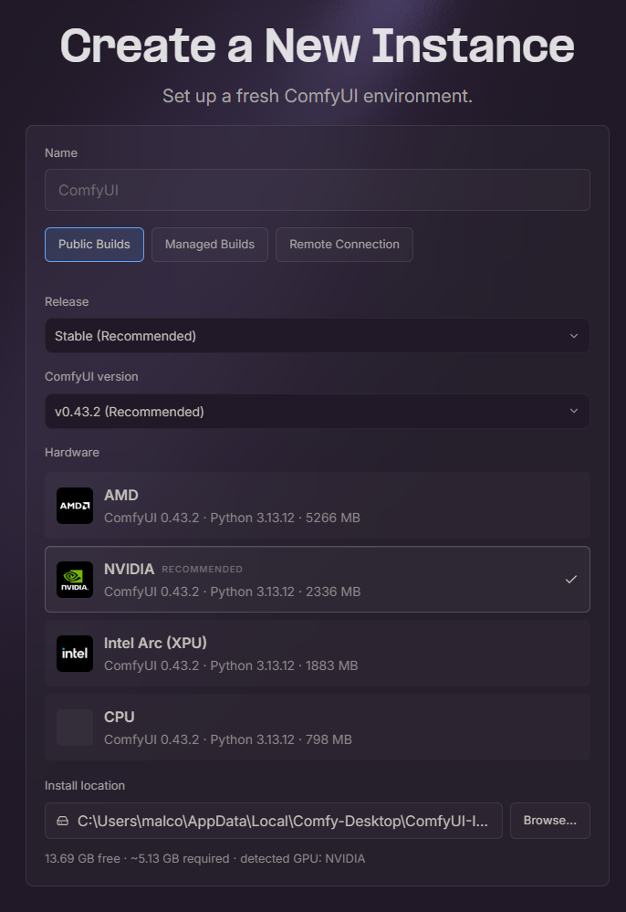
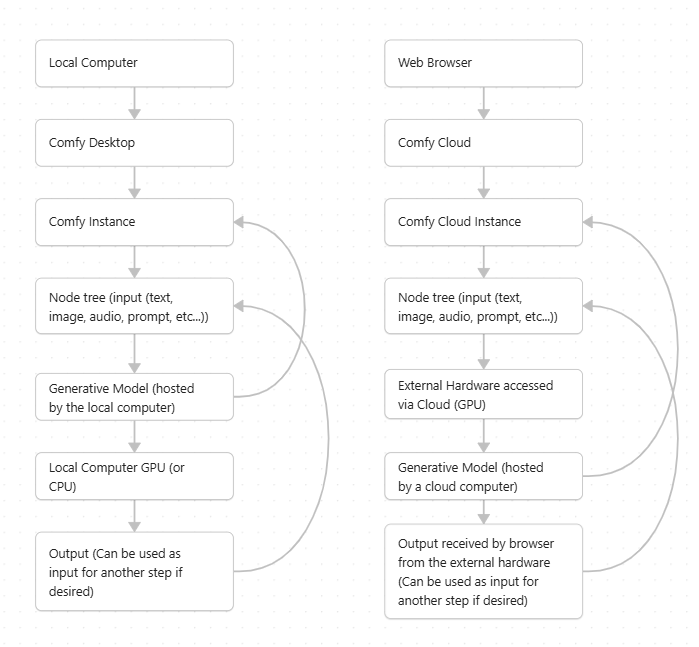

# Installation Guide

This is a quick installation guide for ComfyUI's desktop version.* (*A cloud version that can run on the browser is also available, this will also be explained here)

## Step 1: install ComfyUI Desktop

To install ComfyUI Desktop, you must go to their website and press the ["Download Desktop"](https://comfy.org/download/) button to download the installer*. Depending on your computer's operating system, you can download the appropriate version (Windows, MACOS, Linux). Once the installer is downloaded, you can open it, follow the install procedure, and once that is done ComfyUI will be fully installed on your computer.

*You do not need an account to use Comfy Desktop

## Step 2: Creating an instance

To begin working with ComfyUI, you must create an instance first. Which is a dedicated ComfyUI environment to store all of the information, files and models you wish to use. When creating a new instance, you will be presented this screen first:

On this screen, you can choose which release(version) of ComfyUI to install in the "release" and "ComfyUI version" sections, witch computation support configuration to install in accordance to the hardware you wish to use (NVIDIA/AMD/INTEL GPUs or CPU) in the "hardware" section and finally where you wish to create your instance in the "install location" section.

## Step 3: The workspace within the instance

Once you have created an instance and downloaded all the necessary prerequisites, you will be greeted by the template menu within the ComfyUI instance you created. Once you see this screen, ComfyUI is now ready to use and you can now proceed to use premade templates for specific actions (image-to-video, text-to-image, etc...) or create custom workflows using multiple prompts, functions and generative models.

### Notes on working with Comfy Desktop

ComfyUI Desktop enable their user to create workflows that utilize multiple generative models all within a local space that is their computer. Consequently, before beginning to work with Comfy Desktop, it is recommended to have at least 70 GB of free storage space in order to be able to handle the majority of available basic workflow templates ComfyUI makes available as you will have to download the models they use (can go from 50 GB to 100+ GB). And if you will be working with multiple generative models at once, the storage requirements will get larger and larger since each generative model must be installed on your computer in order for ComfyUI to function. Also, the computation tasks will have to be handled by the computer on which the instance is running. So if you wish to perform generative tasks, the recommended computer specs are a GPU (at mimimum a NVIDIA RTX 3060/Radeon RX 7600 XT or newer) with 12+ GB of VRAM and 32+ GB of DDR4 (or newer) RAM available. The more intensive the task (or if you simply wish to accomplish them faster) the more processing power (a stronger GPU) and memory (more available RAM and VRAM) will be needed.

## Alternative Setup: Comfy Cloud

If your devices do not have sufficient computing power to run the models within your ComfyUI workflows, you can use Comfy Cloud instead. Which enables you to use ComfyUI's features and run your tasks on powerful remote hardware.

## Step 1: Create an Account

To access [Comfy CLoud](https://comfy.org/cloud/), you must start by creating a Comfy account. [You can easily do so on the website](https://comfy.org/login/?returnTo=%2F).

## Step 2: Open a Comfy Cloud Workspace

After creating a Comfy account, you can click on the "Try Cloud for free" button and it will bring you to a screen where you can choose to start either from a template, a tutorial or a blank canvas if you wish. Pick any option and you can then immediately begin working*.

*In Comfy Cloud, models are already pre-installed. So no need to wait for the remote hardware to install the models you wish to use.

### Extra notes

Some models require a paid commercial license to use. Some model outputs are subject to a specific copyright license and consequently are sometimes not egible for commercial use*. Each model has its own distinct rules for the instructions it can take, the ouptuts it can create, and more. Reading the terms of service and specifications of the models you wish to use in your ComfyUI workflows before implementation is strongly recommended.

*All pre-installed models available to use on Comfy Cloud are cleared for commercial use.

For those who wish to use Comfy Cloud. After creating an account, you can perform 5 output generations for free. After that, you will have to pay for one of the three monthly single user plans (Standard (18$), Creator (28$) and Pro (80$)) or a Team plan (630$) for a team collaborating on a single workflow. If you decide to opt for a Creator, Pro or Team plan, you gain access to the ability to import your own models from either HugginFace or Civitai, if the model you wish to use isn't already within Comfy's library. Comfy Desktop in comparison can import models from outside HugginFace or Civitai. But implementation, custom nodes, and troubleshooting will have to be done by yourself.

### Extra: Pipeline Diagram

### All Presentation references

-ComfyUI Official Website
Comfy-Org. (n.d.).
https://comfy.org/

-ComfyUI Official Documentation
Comfy-Org. (n.d.).
https://docs.comfy.org/

-Snyk Labs, Onitza-Klugman, R., McNamara, R., & Ward, E. (2024, December 16). Don’t get too comfortable: Hacking ComfyUI through custom nodes. Snyk Labs. 
https://labs.snyk.io/resources/hacking-comfyui-through-custom-nodes/

-ComfyUI – Official Security Policy, Comfy-Org. (n.d.). Security policy. GitHub.
https://github.com/Comfy-Org/ComfyUI/blob/master/SECURITY.md

-Doyensec, Sisco, S. (2025, March 27). ComfyUI Manager RCE via custom node install. Doyensec Security Advisory.
